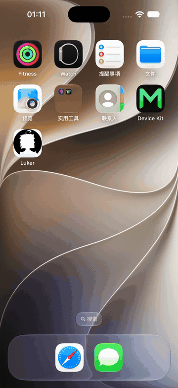

# Luker iOS App (Backend-in-App)

This directory contains an iOS shell app that runs the Luker backend locally on the device and opens it in a WKWebView. It mirrors the architecture of `android-app/`:

- **WebView UI**: loads `http://127.0.0.1:8000` (probes 8000..8049 when busy)
- **Backend runtime**: Node.js Mobile (`NodeMobile.xcframework`, arm64 device, jitless)
- **App boot flow**:
  1. copy the bundled `nodejs-project` tree to app-private storage (`Application Support/luker-runtime`)
  2. start Node on a background thread with `bootstrap.js`
  3. poll `POST /api/ping` until the local server answers
  4. open the WKWebView

The bootstrap script itself is shared with Android: the build copies `android-app/app/src/main/assets/nodejs-project/bootstrap.js` into the staged bundle, so the two shells stay behavior-identical.

## Demo



The clip starts at first-run setup and ends on the main screen served by the in-app Node runtime.

## Distribution model

Both CI flavors produce an **unsigned** IPA. Apple's App Store terms conflict with the AGPL free-redistribution requirements, so the app is not published to the App Store, and the project never ships a signed IPA. Users sign it with their own Apple ID via AltStore/SideStore (free Apple IDs expire after 7 days; paid developer accounts last a year). See `docs/guide/ios.md` for the user-facing install guide.

## Local build

Prerequisites: macOS with Xcode, `brew install xcodegen`.

From repository root:

```bash
npm ci --omit=dev
bash ios-app/scripts/build-ios-ipa.sh debug
```

Equivalent manual steps:

```bash
node ios-app/scripts/fetch-nodejs-mobile.mjs
node docker/build-lib.js
xcodegen generate --spec ios-app/project.yml
xcodebuild -project ios-app/Luker.xcodeproj -scheme Luker -configuration Debug -sdk iphoneos -arch arm64 build
```

The `Luker.xcodeproj` and `Luker/Info.plist` are generated by `xcodegen` from `project.yml` and are not committed; regenerate them after editing `project.yml` or adding sources.

Output: `ios-app/dist/Luker-<version>-ios-unsigned.ipa`

Runtime fetch policy (mirrors the Android script):

- Default runtime asset: the latest `nodejs-mobile-ios.zip` release of `funnycups/nodejs-mobile` containing `NodeMobile.xcframework` (ios-arm64 device slice) plus Node headers.
- By default the script enforces `Node major >= 24`, verified against `include/node/node_version.h`.
- Override knobs (same names as Android):
  - `NODEJS_MOBILE_ASSET_URL` (direct runtime zip URL)
  - `NODEJS_MOBILE_ASSET_NAME` (optional display/name hint)
  - `NODEJS_MOBILE_ASSET_FILE` (local runtime zip path; if omitted, `./nodejs-mobile-ios.zip` is auto-detected when present)
  - `NODEJS_MOBILE_RUNTIME_MAJOR` (manual major version hint)
  - `NODEJS_MOBILE_TAG` (`latest` or concrete tag, used when no direct asset URL is provided)
  - `NODEJS_MOBILE_OWNER` / `NODEJS_MOBILE_REPO`
  - `NODEJS_MOBILE_MIN_MAJOR` (default `24`)
  - `NODEJS_MOBILE_ENFORCE_MIN_MAJOR` (`1` by default; set `0` to bypass)

## CI model

Mirrors `android-apk.yml`:

- `push` on any branch: build unsigned debug IPA artifact.
- `push` on any tag: validate tag against `package.json` version, build unsigned release IPA, publish to the GitHub Release for that tag.
- `workflow_dispatch`: manual `debug` / `release` selection.

## Data and update model

- Runtime root: `Application Support/luker-runtime` (refreshed from the app bundle whenever the app build changes; `whitelist.txt` is carried across refreshes via `_runtime-persist`).
- Data root: `Application Support/luker-data` — user chats, characters, server plugins (`plugins/`) and global third-party extensions (`extensions/third-party/`) live there and survive app updates.
- Server plugins reach the runtime root through the `_server-plugins` symlink, same as Android.
- Updates arrive as a new IPA installed over the old one; app data persists because the data root is outside the refreshed runtime root.

## Platform limits (differences from Android)

- iOS suspends the app in the background: the local server only runs while the app is in the foreground. There is no equivalent of the Android foreground service.
- The embedded Node runtime is built jitless (no JIT, no WebAssembly on iOS); local inference, AVIF/WebP images and non-OpenAI exact tokenization are degraded — same as the HarmonyOS build.
- Out of scope for the first shell version: push-style reply notifications, the custom-endpoint override dialog, safe-mode extension tripping, and CDP debug capture. The diagnostics screen shares `bootstrap.log` and Node `report.*.json` artifacts instead of the Android diagnostics bundle.
